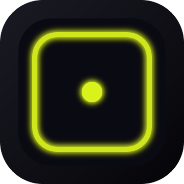

# Moody Glow

Elevate your iPhone notifications with beautiful animated glowing effects around the screen.



---

## ✨ Features

- **6 Unique Animation Styles:**
  - Contrary
  - Light Bar
  - Outline
  - Particles
  - Pendulum
  - Symmetric

- **Custom Colors per App:** Override any app's color with your own choice.

- **Color Cycling:** Automatically cycle through app colors when multiple apps send notifications.

- **Glow Thickness:** Customize the line width from 1 to 12 pixels.

- **Speed Controls:** Adjust breathing speed and draw speed independently.

- **Blackout Mode:** Darken the screen with only the glow visible (optional wake after animation).

- **Smart Filtering:** Lockscreen, Universal, DND, and Active App controls.

- **Lock-Aware:** Persistent glow on lock screen, auto-dismiss when unlocked.

- **Bilingual UI:** Arabic + English.

---

## 📱 Compatibility

- **iOS:** 14.0 – 18.7
- **Jailbreak:** RootHide / Rootless / Rootful
- **Devices:** iPhone X and newer (notch devices)

---

## 📦 Installation

1. Add the repository to **Sileo** or **Zebra**.
2. Install **Moody Glow**.
3. Respring your device.
4. Open **Settings → Moody Glow**.

---

## 🎨 How to Use

### Animation Style
Open **Settings → Moody Glow → Animations → Style** and pick from 6 different animations.

### Custom App Colors
Open **Settings → Moody Glow → Animations → Custom App Colors** and assign a custom color to any app.

### Color Cycling
Toggle **Color Cycling** to enable automatic color rotation between apps.

### Glow Thickness
Use the **Glow Thickness** slider to adjust the line width (1-12 px).

### Blackout
Enable **Blackout** to darken the screen while the glow plays. Optionally enable **Wake screen after Blackout**.

---

## 🛠️ Build from Source

```bash
git clone https://github.com/mody-iq/MoodyGlow.git
cd MoodyGlow
make package FINALPACKAGE=1
